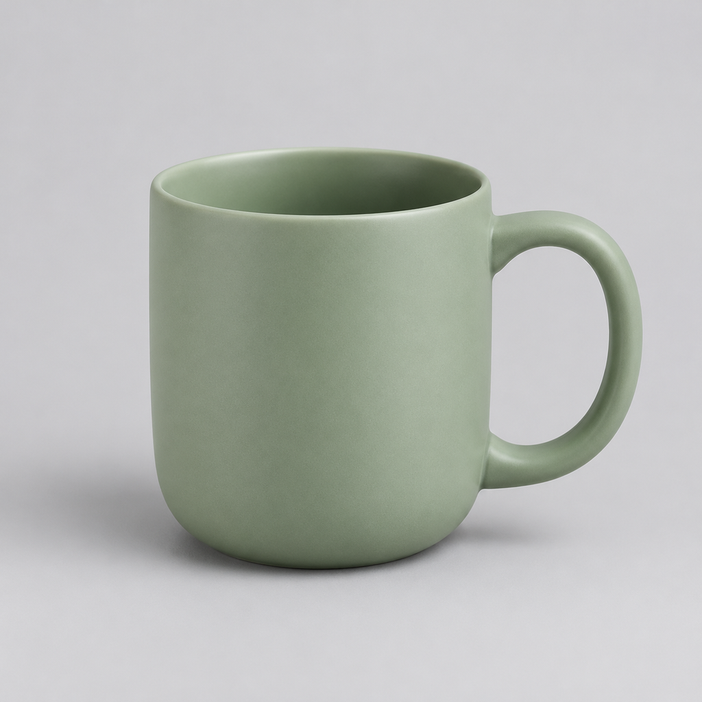
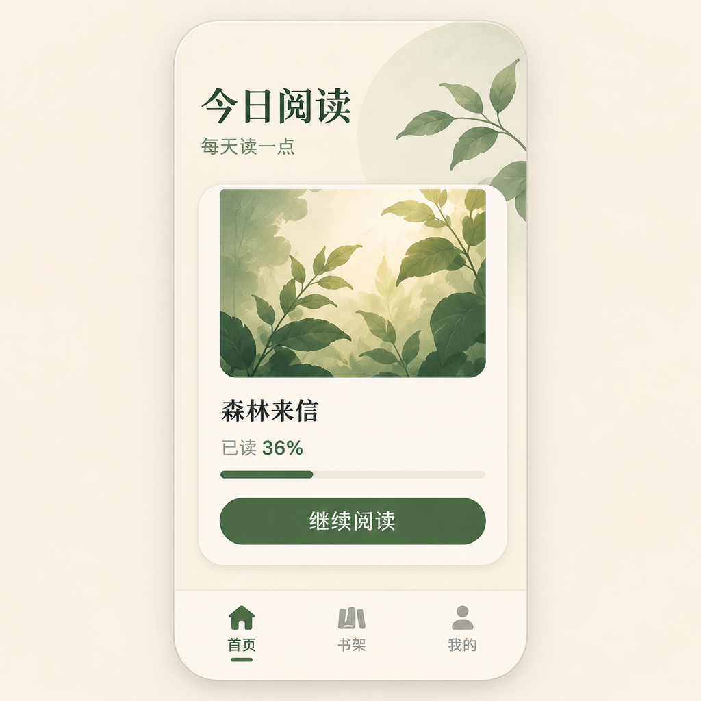
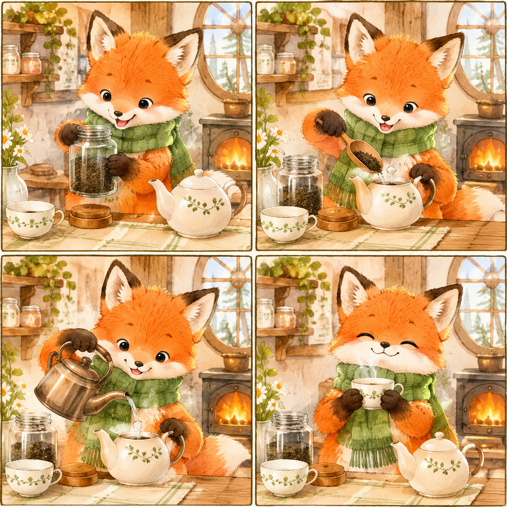

# Codex Draw

[](https://github.com/huanghonggit/codex-draw/actions/workflows/ci.yml)

给 Codex 用的绘图 skill：用自然语言生成图片、修改图片，或请求服务商支持的 GIF 动图。内置 **12 个场景**，场景与模型可分别扩展。

## 安装与使用

1. 从 [Releases](https://github.com/huanghonggit/codex-draw/releases/latest) 下载 ZIP，核对同页 SHA256SUMS。
2. 解压，将 `codex-draw` 文件夹放到 `~/.codex/skills/`。
3. 新开会话，输入：

```text
使用 $codex-draw，帮我配置图片服务。
使用 $codex-draw，设计一张中文阅读应用首页。
使用 $codex-draw，把这张商品图做成冬季海报，再生成循环 GIF。
```

支持 Windows / macOS，均提供 x64 和 ARM64 程序；使用发行包无需安装 Python、Node 或 Go。

## 案例效果

以下展示实际模型返回的文件，完整提示词、参数、验收记录及复现命令见 [案例测试](docs/EXAMPLES.md)。此次由 `codex-draw` 规划和验收，已配置的 `codex-image2` 执行图片请求；未将其标为新 CLI 的端到端服务测试。

| 商品参考图 | 冬季场景编辑 |
| --- | --- |
|  |  |

| 中文 UI 视觉稿 | 四格故事分镜 |
| --- | --- |
|  |  |

**商品 GIF**


实测 9 帧、1.8 秒、439×388，无限循环；首尾存在跳变，未达到无缝要求。

## 支持哪些场景

角色循环表情、游戏动作素材、角色设定、商品海报、商品动图、局部编辑、草图渲染、UI 视觉稿、知识图解、图片翻译、故事分镜，以及 SVG 图标设计交接。

GIF 取决于服务商能力；SVG 目前提供设计交接说明。输出的文字、身份保持和动作效果需要验收，界面视觉稿不包含前端代码。

## 如何扩展

- **加场景**：新增场景配置、提示词和验收清单，无需改代码。
- **加模型**：同协议模型新增一个 JSON；新协议需实现适配器。
- **保留自定义扩展**：通过 `CODEX_DRAW_REGISTRY` 指定外部完整注册表。

详见 [扩展协议](codex-draw/references/extensions.md) · [使用与开发指南](docs/USAGE.md) · [完整方案](docs/PLAN.md)。

基于 [codex-image2-skill](https://github.com/fengfengzhidao/codex-image2-skill)，采用 MIT 许可。参见 [来源说明](docs/SOURCES.md) 和 [署名](NOTICE.md)。
