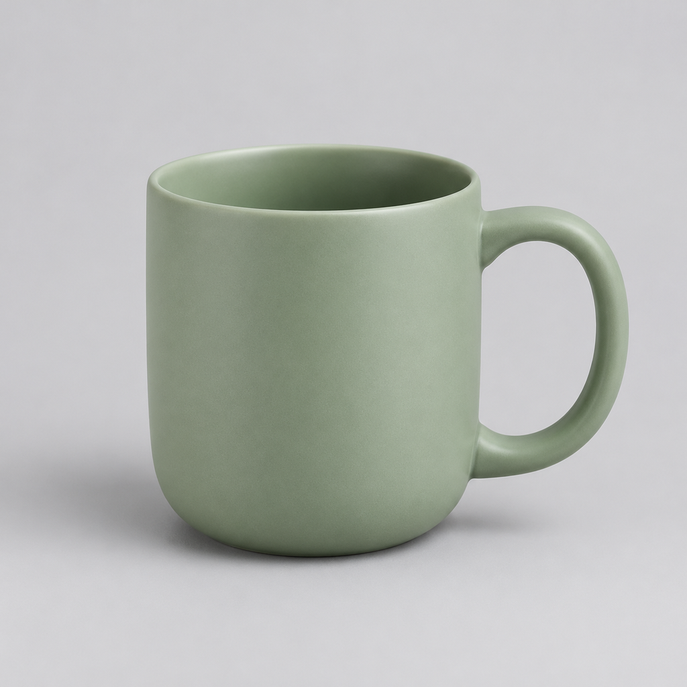
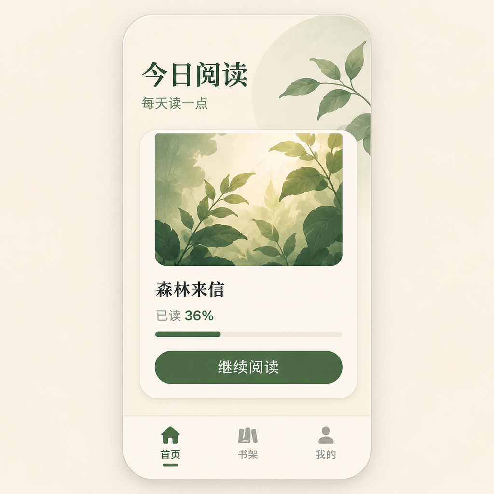
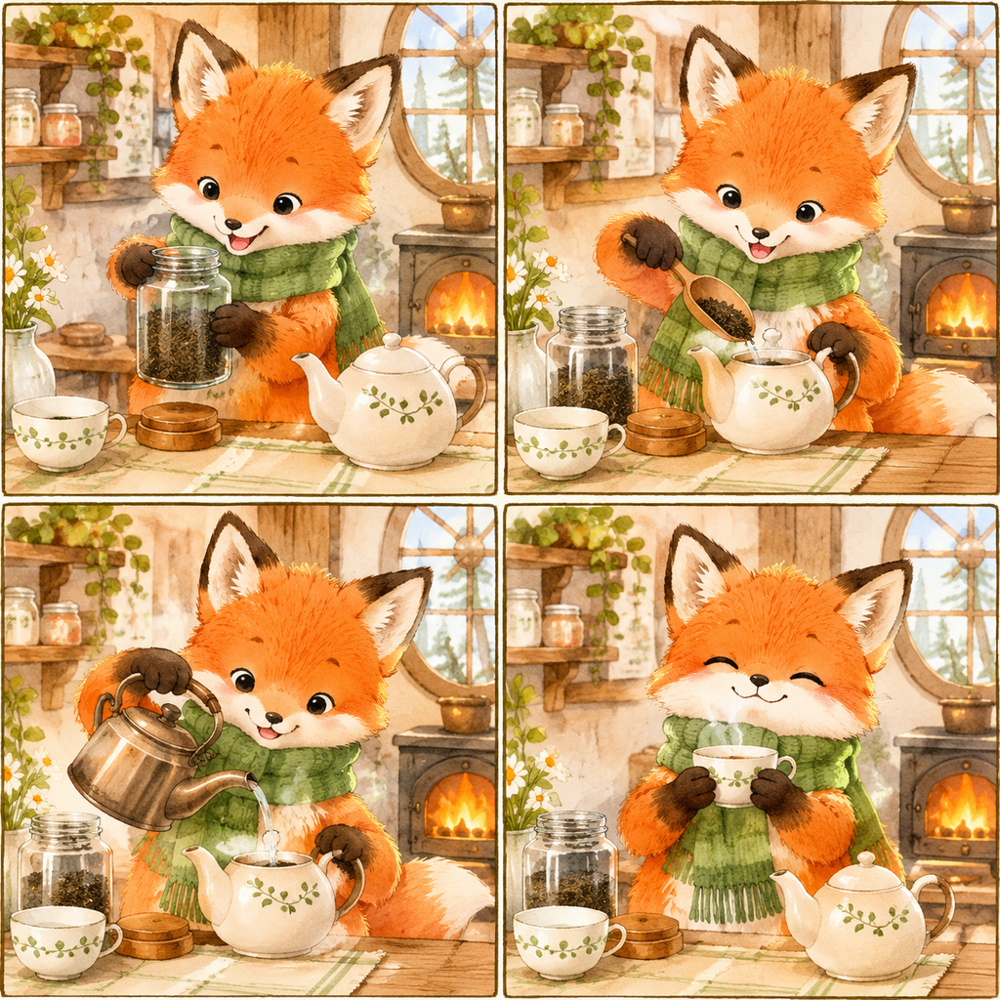

# 案例测试与生成结果

这组案例展示真实服务返回的图片和动图，保留原始文件，没有用程序绘制的占位图替代生成结果。案例定义见 [cases.json](../examples/cases.json)，简报在 [briefs](../examples/briefs/)，完整提示词和实测元数据在 [results](../examples/results/)。

## 执行范围

- `codex-draw` 负责场景计划、模型能力检查和输出文件解码验收。
- 本次图片请求由已经配置的 `codex-image2` 执行；没有自动迁移或复制凭据。
- 静态图使用 `auto`，服务实际选择的模型记在每个结果 JSON 中；GIF 显式指定 `gpt-image-2.6-sunburst`。这是服务商模型别名，不是官方能力认证。
- 每个案例最多一次提交，不自动重试。视觉检查使用图像理解工具，不能代替人工设计验收。
- 所有素材都是为本仓库新生成的虚构商品及角色，没有使用用户的个人照片。

## 测试结果

全部实际使用服务商别名 `gpt-image-2.6-sunburst`。以下“通过”仅针对记录的检查项；“部分通过”表示产物可解码且包含目标内容，但仍有要求未达到。

| 案例 | 实际产物 | 验收 |
| --- | --- | --- |
| 商品参考图 | PNG · 1024×1024 | 通过：单杯、绿色哑光、无文字 |
| 冬季商品编辑 | PNG · 1024×1024 | 部分通过：场景符合；杯身比例、杯缘及杯柄厚度略变 |
| 中文阅读 UI | PNG · 1024×1024 | 通过：8 处指定中文均正确，页面结构清晰 |
| 狐狸泡茶分镜 | PNG · 1024×1024 | 通过：四格顺序与角色基本连贯；勺子角度略不自然 |
| 商品 GIF | GIF · 439×388 · 9 帧 · 1.8 秒 | 部分通过：真实动图、无限循环；尺寸和无缝要求未达标 |

### 商品参考图 → 冬季编辑

| 新生成的商品参考图 | 根据参考图编辑背景 |
| --- | --- |
|  |  |

### 中文 UI 与四格分镜

| 中文阅读应用 | 小狐狸泡茶 |
| --- | --- |
|  |  |

### 商品 GIF


原始 GIF 包含 9 个不同帧，每帧 200ms，循环标记为无限循环。请求尺寸为 1024×1024，实际返回 439×388；首尾像素不一致，抽帧检查发现蒸汽形态衔接跳变、烟圈形态与局部明暗变化。因此这里展示的是实际生成结果，**不作为无缝动画通过案例**，也未宣称完成动态播放人工验收。

未补帧、变速或修改首尾；完整元数据与验收意见见 [GIF 记录](../examples/results/winter-product-loop.json)。

## 复现

维护脚本需要 Python 3；普通 skill 使用不需要 Python。先下载发行版并配置服务。以下命令在仓库根目录运行：

```powershell
$cli = Join-Path $env:USERPROFILE ".codex/skills/codex-draw/bin/codex-draw-windows-amd64.exe"

# 离线验证场景计划和已发布案例，不发送图片请求
python scripts/run_examples.py --cli $cli
python scripts/check_examples.py

# 重新生图前，把 examples/results 中已有结果另行保存并腾出输出位置。
# --live 会发送可能计费的请求；全套为 5 次：参考图、海报、UI、分镜、GIF。
python scripts/run_examples.py --cli $cli --live
```

默认按依赖顺序执行：先生成商品参考图，再编辑冬季海报，最后使用海报生成 GIF。已有文件拒绝覆盖。可用 `--case reading-ui` 只运行一个案例；GIF 需要已存在的冬季海报。

复现此次使用的旧后端路径时显式增加参数：

```powershell
$legacy = Join-Path $env:USERPROFILE ".codex/skills/codex-image2/bin/codex-image2-windows-amd64.exe"
python scripts/run_examples.py --cli $cli --image2-cli $legacy --case reading-ui --live
```

省略 `--image2-cli` 时，图片请求也由 `codex-draw` 完成；这需要它自己的服务配置。输出可能随服务、模型和时间变化，不保证逐像素复现。

## 自动校验与人工验收

CI 仅离线检查示例文件的 SHA-256、格式标记、尺寸、参考文件和验收记录，不调用付费服务。生成完成后还应核对文字、主体、场景约束与 GIF 播放效果，再更新 JSON 中的 `visual_review`。新增或重新生成的结果默认标为 `pending`，不会被案例校验当成已验收。
